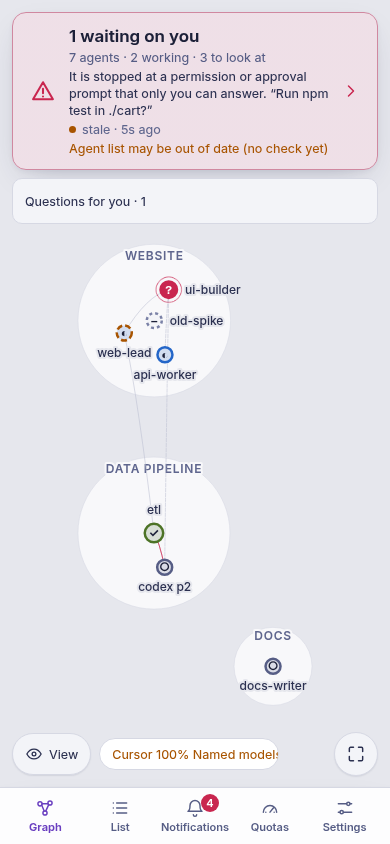
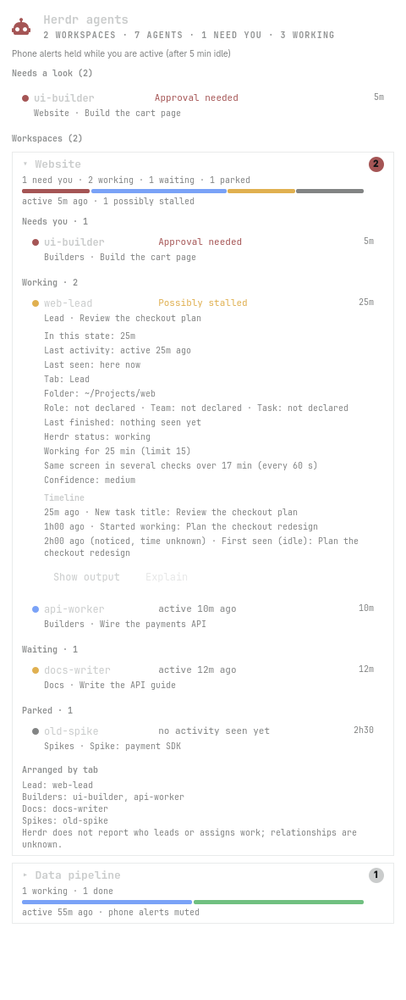

# Herdr attention dashboard

See at a glance what your Herdr agents are doing, workspace by workspace:
who is working, waiting, parked or done, what each one is working on, and
what needs you (a question, an approval, a failure, a possible stall).
It is read-only: it watches, it never types into an agent.

- A small **collector** runs in the background and listens to Herdr.
- A **bar icon** on the Omarchy desktop shows a count; click it for the panel.
- A private **phone page** over Tailscale, behind a passphrase.
- **Phone alerts** (ntfy) are built but off until set up. See [docs/phone.md](docs/phone.md).

With sample data:

| Phone | Bar panel |
|---|---|
|  |  |

More: [agent selected](docs/screenshots/phone-graph-selected.png), [desktop](docs/screenshots/desktop-graph-selected.png),
[list fallback](docs/screenshots/phone-list.png), [workspace](docs/screenshots/phone-workspace.png),
[agent](docs/screenshots/phone-agent.png),
[settings](docs/screenshots/phone-settings.png),
[desktop browser](docs/screenshots/desktop-workspace.png).
All screenshots use made-up sample data.

## Install

```bash
cd ~/Projects/herdr-attention-dashboard
scripts/install.sh
```

This runs the tests, installs the `herdr-attention` command, starts a user
service and adds the icon to your bar. No sudo. If the icon does not show up,
run `omarchy restart shell`.

## Choose what to watch

Nothing is watched until you switch it on: on the phone page (the sliders
button, top right), in the bar panel under **Workspaces and settings**, or:

```bash
herdr-attention workspace list
herdr-attention workspace enable w4
```

## Use it

- **Bar icon**: the number is how many things need a look. Red means a
  question, an approval or a failure.
- **Phone / browser**: opens on the graph: workspaces as regions, agents as
  nodes in Herdr's own status colours. Tap an agent for its summary and
  details; the buttons at the top give the to-look-at list, workspaces, view
  options, settings and the text list.
- **Bar panel**: what needs a look, then one card per workspace.
  Open a workspace to see its agents by state (needs you, working, done,
  waiting, parked) and how its tabs are arranged; open an agent for its task,
  evidence, timeline, finished work and recent output.
  Panel keys: ↑/↓ through "needs a look", Enter to open, `o` output, `r` mark read.
- **Terminal**: `herdr-attention status` for the same list.

Times with `≥` mean the state was already there when the collector first
looked, so the real start is unknown. "Possibly stalled" is a guess.

## Start a linked worker

```bash
herdr-spawn worker-1 --role backend --reports-to me --brief /path/brief.md -- "Implement the brief"
herdr-attention routing show --role backend
```

Routing follows project accounts and observed quota walls; launches default to
full permissions. See [relationships](docs/relationships.md) and
[configuration](docs/configuration.md) for overrides, hooks and sandbox reasons.

## Check or undo

```bash
herdr-attention doctor          # is everything connected?
scripts/uninstall.sh --rollback # back to the previous version
scripts/uninstall.sh            # remove (keeps your settings and history)
scripts/uninstall.sh --purge    # remove everything, including keyring entries
```

## More

- [docs/requirements.md](docs/requirements.md): what was agreed, what is only proposed, and where each part lives
- [docs/design.md](docs/design.md): the workspace view and the graph: requirement, what the data supports, states, layout
- [docs/relationships.md](docs/relationships.md): coordinators, reporting lines, teams, the launch helper
- [docs/summaries.md](docs/summaries.md): AI summaries (the only model calls), readable output, mark-as-read
- [docs/architecture.md](docs/architecture.md): how it works
- [docs/configuration.md](docs/configuration.md): every setting
- [docs/phase0-runtime.md](docs/phase0-runtime.md): what was verified on the real Herdr
- [docs/testing.md](docs/testing.md): what is tested against the real runtime and what against fixtures
- [docs/install-and-rollback.md](docs/install-and-rollback.md): what the installer touches
- [docs/phone.md](docs/phone.md): phone page and ntfy, the setup still waiting for approval

## Desktop overview (v0.8.4)

After installation, **Super+Shift+H** opens **Herdr overview** in its own app
window; press it again to bring that window back. **Open in Herdr** on an
agent or notification focuses its Herdr workspace, tab and pane, raises the
Herdr terminal, and leaves the overview on that agent's conversation.
Focusing marks the pane seen in Herdr. It never types into the terminal.

The desktop listener is loopback-only and needs CSRF on writes. The phone
listener and tailnet routes have no focus capability. Never point Tailscale
Serve at the desktop listener; installation does not change Tailscale.

Listener defaults and routes live in `herdr_attention/ui_contract.json`.
Override `[desktop] bind` (IPv4 loopback only), `port`, or `enabled` in the
same `config.toml` the collector reads. The overview wrapper reads that
config too; the Omarchy plugin opens notifications through the wrapper.
After changing the port, restart only `herdr-attention.service`.

When changing shared definitions, run `python3 scripts/gen_ui_contract.py`.
`python3 scripts/gen_ui_contract.py --check` rejects stale generated values,
copied routes, ports, focus methods or action labels. The installer runs it.

## Credits

- Service marks (Claude, Codex, Cursor, Antigravity, Grok, Grok Bot, GitHub Copilot, OpenCode and
  others) are Omarchy's agent icons from its built-in Agents bar plugin (`omarchy.agents`,
  https://github.com/basecamp/omarchy, MIT, Copyright (c) David Heinemeier Hansson), copied into
  `third_party/omarchy-agents/` with that licence. The marks are their companies' trademarks and
  only say which service an account belongs to.
- Inter font: see `herdr_attention/web/Inter-LICENSE.txt`.

## License

MIT, see [LICENSE](LICENSE). Third-party files keep their own licences (see Credits).
